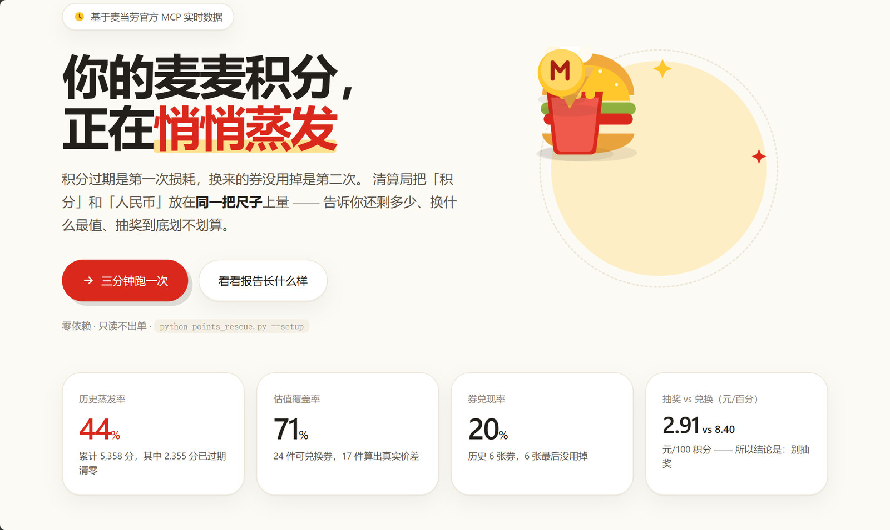
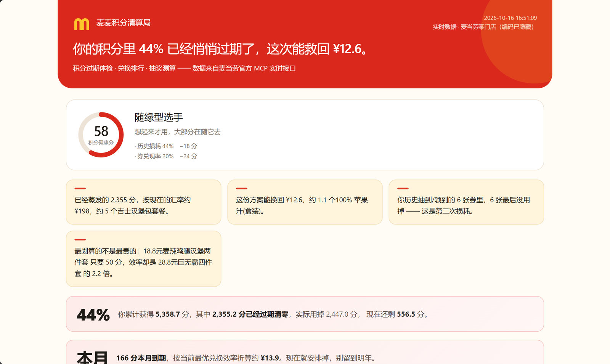
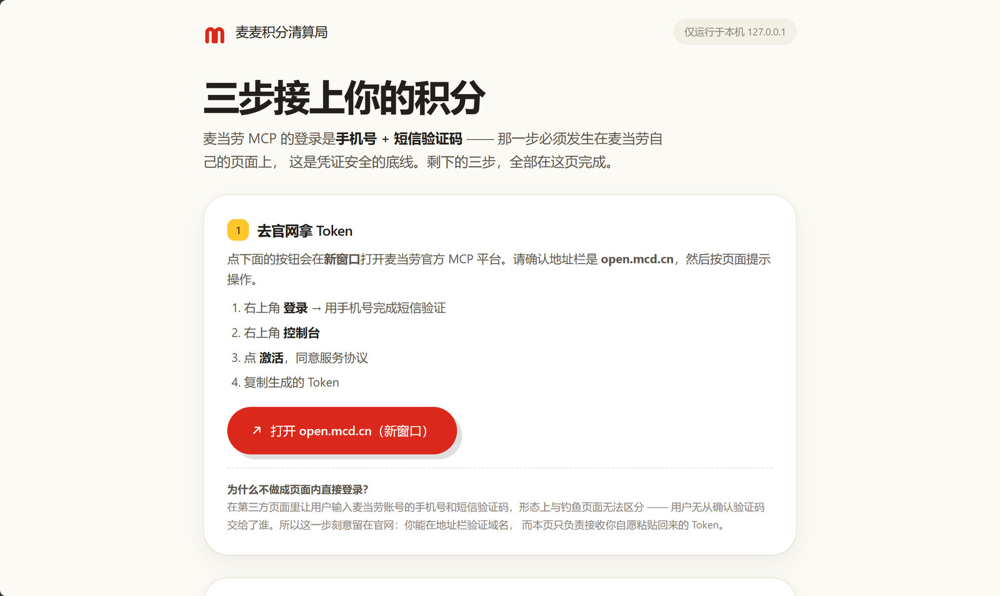

# 麦麦积分清算局 · mcd-points-rescue

<p align="center">
  <strong>你的麦麦积分里，有多少已经过期清零了？</strong><br>
  <strong>抽奖到底是不是智商税？别猜，算。</strong>
</p>

<p align="center">
  基于麦当劳 MCP 的积分资产处置助手 —— 把「积分」和「人民币」放在同一把尺子上量
</p>

<p align="center">
  <a href="site/index.html"><b>项目展示页</b></a> ·
  <a href="docs/sample-report.html">样例报告</a> ·
  <a href="docs/USAGE.md">使用指南</a> ·
  <a href="DESIGN.md">设计系统</a>
</p>

<p align="center">
  
</p>
<p align="center"><sub>项目展示页 —— 卡通风格，麦当劳红金配色，手绘 SVG 插画</sub></p>

<p align="center">
  
</p>
<p align="center"><sub>报告第一屏 —— 一句话结论 + 积分健康分 + 趣味事实，往下才是技术细节</sub></p>

---

## 想用？复制这一行，发给你的 AI

```
读一下 https://raw.githubusercontent.com/wdzju/mcd-points-rescue/main/SKILL-lite.md 然后按里面的流程帮我查麦当劳积分
```

就这样。**不用克隆、不用装 Python、不用敲任何命令。**

AI 会自己去读那份说明，然后调用麦当劳接口、算出结果、用大白话讲给你听。

**唯一的前提**：你的 AI 得能连上麦当劳 MCP。把这段加进客户端的 MCP 配置：

```json
{"mcpServers":{"mcd-mcp":{"type":"streamablehttp","url":"https://mcp.mcd.cn","headers":{"Authorization":"Bearer 你的Token"}}}}
```

Token 去 <https://open.mcd.cn/mcp> 免费申请（手机号验证，约 1 分钟），替换掉「你的Token」。

各家客户端填的位置不同，但认的都是 `mcpServers` 这个字段：

| 客户端 | 在哪里填 |
|---|---|
| Claude Desktop | 配置文件里的 `mcpServers` |
| Cursor | Settings → MCP |
| Cherry Studio | 设置 → MCP 服务器 |
| WorkBuddy | 【连接器】→【自定义连接器】→【配置 MCP】 |
| 其他 | 找设置里的 MCP / 自定义连接器 |

**不绑定任何特定客户端** —— 只要它能连 MCP，这套流程就一样。

> ⚠️ **纯网页对话用不了**（ChatGPT 网页、Kimi 网页这类）：它们没有 MCP 能力，
> 连不上 `mcp.mcd.cn`，只能看演示数据，算不出你自己的账户。
> 需要能装 MCP 的桌面客户端或 IDE 插件。

配好之后，上面那句话就能用了。**以后再问，直接说「帮我查麦当劳积分」就行**，
不用再贴链接。

---

## 其他用法

| 你是谁 | 做什么 |
|---|---|
| **只是想看看效果** | 点上面的 **项目展示页** |
| **想把它变成常驻技能** | 一条 curl 装进 skills 目录，见 [轻量版安装](#先试轻量版一条命令装好不用克隆不用-python) |
| **要精确计算 + HTML 报告** | 克隆仓库跑 Python，见 [完整版](#完整版克隆仓库生成-html-报告) |

后两种是进阶用法。**大多数人只需要上面那一行字就够了。**

> **看不到展示页？** GitHub 默认只显示 HTML 源码，不渲染页面。
> 需要仓库主人开一次 Pages：`Settings → Pages → Source 选 Deploy from a branch → 分支 main、目录 / (root) → Save`。
> 一分钟后 `https://wdzju.github.io/mcd-points-rescue/` 就能访问，展示页与样例报告都是活的。
> 详细步骤见 [docs/USAGE.md](docs/USAGE.md)。

---

## 先看结论

跑完之后，报告第一屏长这样：

```
你的积分里 44% 已经悄悄过期了，这次能救回 ¥12.6。

积分健康分 58 ·「随缘型选手」— 历史损耗 44%，券兑现率 20%

兑换排行（元/100 积分，越高越划算）
  · 18.8元麦辣鸡腿汉堡两件套    50 分  → 8.40
  · 22.8元2份麦辣鸡腿堡       500 分  → 7.04
  · 28.9元板烧四件套          800 分  → 3.64
  · 21.9元巨无霸可乐组合        800 分  → 1.70

抽奖：单次 24 分，折算兑现率后 2.91 元/100 分 → 不如直接兑换
```

下面三件事，都来自同一个真实账号。

### 一 · 你的积分里 44% 已经蒸发了

> 累计获得 **5,358.7 分**，其中 **2,355.2 分已经过期清零**。
> 可用余额只剩 556.5 分，本月还有 166 分要到期。

App 里只显示余额，不显示损耗。这是本项目第一个要补上的信息。

### 二 · 越贵的券，越不划算

> 50 分的「麦辣鸡腿汉堡两件套」：省 ¥4.20 → **8.40 元 / 100 积分**
> 800 分的「板烧四件套」：省 ¥29.10 → **3.64 元 / 100 积分**
>
> 积分单价贵 16 倍的大券，单位效率只有小券的 **43%**。

`21.9元巨无霸可乐组合` 这类券不是商品，是「花 21.9 元买它」的资格 ——
所以收益是**原价与应付价的差额**，不是券面价格。这是本项目推翻的第一个直觉。

### 三 · 抽奖不划算，而且理由不止一个

> 按通用假设，抽奖中性效率 11.28 元/百分，看着比兑换（8.40）还划算。
>
> 但换成你自己的数据后，两层修正把结论推翻：
> 一是中奖概率按你历史中奖记录校准，二是**奖品也是券** ——
> 而你历史抽到的 **6 张券，一张都没用掉**（兑现率 20%）。
>
> 折算后抽奖效率只剩 **2.91 元/百分** —— 明确不如直接兑换。

「看着更划算」和「实际更划算」之间，差的是方差和行为数据，不是算法。

上面这些数字全部由麦当劳 MCP 的真实返回计算，可复现、可质疑、可改参数重跑。

> 注意：数据来自本人账号的一次抓取（仅含积分余额与商品价格，无身份信息）。
> 你的账号结论会完全不同 —— 换上自己的 Token 跑 `--live` 才是你的答案。
> 想看不含真实数据的版本，仓库内置了 `--demo` 合成样例。

---

## 它解决三个问题

| # | 问题 | 传统做法 | 清算局的做法 |
|:--:|---|---|---|
| 1 | 我到底损失了多少积分？ | App 里只看到余额，看不到历史损耗 | 拆出「累计 / 已用 / 已过期 / 本月到期」，直接给损耗率 |
| 2 | 商城里换什么最划算？ | 凭感觉，或按积分从低到高挑 | 算出每张券的 **元/100积分**，直接排序 |
| 3 | 抽奖划不划算？ | 玄学，或"万一中了呢" | 算期望价值，给三种概率假设下的区间，并标注口径 |

关键前提是：商城里能换的**全是折扣券**，抽奖抽出来的**也全是折扣券**。
所以这里没有「商品价值」这回事，只有**价差**。

---

## 与其他「省钱助手」的不同

榜单上已有不少省钱 Skill，它们解决的是 **增量消费**：这一单怎么点更便宜。

清算局解决的是 **存量资产**：账户里这笔已经存在的积分，怎么处置才能少亏一点。

| 维度 | 省钱助手 | 清算局 |
|---|---|---|
| 视角 | 消费决策 | 资产清算 |
| 核心指标 | 省了多少元 | **元 / 100 积分** |
| 关键问题 | 这单怎么买便宜 | 这笔存量怎么花完最值 |
| 抽奖 | 不处理 | 期望值建模，三情景区间 |
| 过期 | 不处理 | 损耗率 + 清仓求解 |

统一的度量单位是全部结论的地基：**只要能把任何一张券折成「元/100积分」，抽奖和兑换就可以直接比大小。** 否则一切对比都是鸡同鸭讲。

---

## 快速开始

### 30 秒：不装任何东西，先看效果

```bash
python points_rescue.py --demo
```

零依赖，只用标准库。跑完生成 `report.html`，浏览器打开即是完整报告。

跑测试（同样零依赖，标准库 unittest）：

```bash
python -m unittest discover -s tests
# Ran 107 tests ... OK
```

### 3 分钟：跑你自己的真实数据

**第一步** — 配置授权（只需做一次）

```bash
python points_rescue.py --setup
```

它会告诉你去哪拿 Token、点哪几个按钮，然后你把 Token 粘贴进去即可。
**Token 保存在你本机的 `~/.mcd-points-rescue/token`，权限收紧为仅本人可读写，
不会写入仓库，也不会上传到任何地方。**

**第二步** — 自检一遍（可选，但建议）

```bash
python points_rescue.py --doctor
```

逐项确认：Token、连接、积分账户、商城券池、抽奖活动、历史订单、门店 ——
任何一项不通都会直接告诉你，不用等跑完才发现。

**第三步** — 运行

```bash
python points_rescue.py --live --city 上海市 --out my-report.html
```

默认按「上海市」搜索门店取菜单价格 —— **这不一定是你的城市**。
请用 `--city` 换成你所在的城市（如 `--city 北京市`、`--city 广州市`），
否则价格锚点用的是别人的门店，算出来的效率会失真。

> 想换成环境变量方式也可以：`export MCD_MCP_TOKEN=你的Token`。
> 解析顺序是 `--token` → 环境变量 → 本地文件。
> 想清除本地保存：`python points_rescue.py --forget`。

**或者用浏览器完成（推荐给非命令行用户）：**

```bash
python points_rescue.py --web
```

会自动打开 `http://127.0.0.1:8723` —— 页面上有三步：点按钮去官网拿 Token → 回来粘贴 → 直接出报告。
服务只监听 `127.0.0.1`，外部访问不到；Token 存本机，不出机器。
生成的报告写到项目根的 `report.html`，不会覆盖 `docs/sample-report.html`。

<p align="center">
  
</p>
<p align="center"><sub>本机配置面板 —— 只监听 127.0.0.1，短信验证那一步刻意留在官网</sub></p>

### 想让它常驻？一条命令装好（WorkBuddy 用户）

> 其他客户端不需要这一步 —— 用上面那句「复制发给 AI」就够了。

**前提**：已在客户端里配好麦当劳 MCP（见上面那张客户端对照表）。

```bash
mkdir -p ~/.workbuddy/skills/mcd-points-check
curl -fsSL https://raw.githubusercontent.com/wdzju/mcd-points-rescue/main/SKILL-lite.md \
  -o ~/.workbuddy/skills/mcd-points-check/SKILL.md
```

重启 WorkBuddy，然后说「帮我查麦当劳积分」。

**连这条都不想敲？** 直接把这 20 行粘进对话框，立刻能用：

```
帮我查麦当劳积分，按这个流程：
1. 调 query-my-account 拿积分数据
2. 调 mall-points-products 拿可兑换券
3. 调 query-nearby-stores 和 query-meals 拿菜单价格
4. 券的收益 = 菜单同名餐品原价 − 券名里的价格
   （例如"18.8元麦辣鸡腿汉堡两件套"，18.8 是我要付的钱，不是券的价值）
5. 全部换算成「元/100积分」再排序：收益 ÷ 积分 × 100
6. 告诉我：蒸发率是多少、最值得换的三张券、本月到期的分怎么花

找不到同名餐品就标"无法估值"，不要用别的商品猜。
```

**轻量版和完整版的区别**：

| | 轻量版（提示词） | 完整版（Python） |
|---|---|---|
| 安装 | 一条 curl，无需克隆 | clone + Python 3.9+ |
| 依赖 | 只要连接器 | Python 标准库 |
| 券名匹配 | AI 模糊匹配，可能有偏差 | 程序精确匹配 + 类目兜底 |
| 清仓方案 | 贪心近似 | 背包最优解 |
| 抽奖 EV | 没有概率时只能定性 | 用历史中奖校准 |
| 输出 | 对话里直接说 | 单文件 HTML 报告 |
| 适合 | 想快速知道结论 | 要精确、要存档、要复现 |

两条路都能用，轻量版负责「先看到结论」，完整版负责「算得准」。

---

### 完整版：克隆仓库，生成 HTML 报告

#### 路线 A · 装成全局技能（推荐，装一次到处能用）

复制这段，整段粘进终端：

```bash
# macOS / Linux
mkdir -p ~/.workbuddy/skills
git clone https://github.com/wdzju/mcd-points-rescue ~/.workbuddy/skills/mcd-points-rescue
```

```powershell
# Windows PowerShell
New-Item -ItemType Directory -Force "$env:USERPROFILE\.workbuddy\skills" | Out-Null
git clone https://github.com/wdzju/mcd-points-rescue "$env:USERPROFILE\.workbuddy\skills\mcd-points-rescue"
```

**重启 WorkBuddy**，然后在任意会话里说：

> 帮我看看我的麦当劳积分

#### 路线 B · 只想试一次，不装

```bash
git clone https://github.com/wdzju/mcd-points-rescue
```

用 WorkBuddy 打开 `mcd-points-rescue` 这个目录（**不是它的上级目录**），说同一句话。

> 为什么强调目录：WorkBuddy 只扫描 `{工作区}/.workbuddy/skills/`。
> 打开上级目录，Skill 不会被加载。

#### 没有 git？

下载 ZIP 解压到对应目录，效果一样：

```
https://github.com/wdzju/mcd-points-rescue/archive/refs/heads/main.zip
```

- 路线 A：解压到 `~/.workbuddy/skills/`（Windows：`%USERPROFILE%\.workbuddy\skills\`）
- 路线 B：解压到任意位置

#### 怎么确认装好了

在 WorkBuddy 里问一句「你有 mcd-points-rescue 这个技能吗」，或者在终端确认文件存在：

```bash
ls ~/.workbuddy/skills/mcd-points-rescue/SKILL.md
```

#### 装上之后会发生什么

```
你说「帮我看看我的麦当劳积分」
      ↓
它检查 Token → 没配
      ↓
先用演示数据跑一份，告诉你报告在哪
      ↓
你觉得有用 → 它引导你在终端配 Token（Token 不经过对话）
      ↓
配好 → 自检 → 跑你自己的账户 → 用大白话讲结论
```

**没 Token 也能启动** —— 这是刻意设计的。先看到效果，再决定要不要配置。

两种装法的完整说明、装完怎么验证、常见问题，都在
[docs/USAGE.md 第 4 节](docs/USAGE.md)。

### 为什么不做一个登录页面

这是个合理的问题，但答案是**不做**，理由有四条：

| # | 理由 |
|---|---|
| 1 | 麦当劳 MCP 的登录是**手机号 + 短信验证码**，那是用户的真实身份凭证。代持或代理意味着替别人保管账号 —— 这是本项目不该承担的合规与安全责任。 |
| 2 | 一旦有后端，项目就从「本地零依赖工具」变成「托管服务」。数据发往哪里、留存多久，全都变成需要回答的问题。 |
| 3 | 麦当劳 MCP 服务规则对 Token 的获取与使用有约束，代申请这类中介行为通常是被限制的。 |
| 4 | 真正的门槛不是「输入一次 Token」，而是「**不知道去哪拿**」。这是文档问题，文档比凭证保管库便宜得多。 |

所以方案是：**引导授权 + 本地保管 + 永不外传**。用户自己拿 Token，工具只负责存和用。

顺带一个实测结论：`open.mcd.cn` 并没有设置 `X-Frame-Options`，技术上**可以**被 iframe 嵌进第三方页面。
但我们不会这么做 —— 在别人的页面里让用户输入麦当劳账号的手机号和短信验证码，
形态上与钓鱼页面无法区分，用户无从确认验证码交给了谁。
所以 `--web` 面板里那一步是**新窗口打开官网**：地址栏可以验证域名，这是唯一无法省略的信任锚点。

---

## 命令行参数

| 参数 | 说明 |
|---|---|
| `--demo` | 内置脱敏样例数据，无需 Token |
| `--live` | 调用真实麦当劳 MCP（需要 Token） |
| `--token` | 直接传 Token，省去环境变量 |
| `--city` | 门店搜索城市，**决定用哪家门店的价格做锚点** |
| `--keyword` | 门店搜索关键词，默认「麦当劳」 |
| `--store` | 手动指定门店编码，跳过自动选店（不同门店菜单差异很大） |
| `--risk` | `conservative` / `balanced`（默认）/ `aggressive`，只影响抽奖判定阈值 |
| `--budget N` | 指定清仓预算积分，默认取「本月将过期积分」 |
| `--out` | HTML 报告路径，默认 `report.html` |
| `--json` | 额外输出结构化 JSON，方便二次开发 |
| `--plan` | 导出可照做的 Markdown 兑换清单（贴进备忘录/提醒事项） |
| `--setup` | 引导申请并本地保存 MCP Token（只需一次） |
| `--doctor` | 自检上游接口与门店，逐项报告哪里不通 |
| `--forget` | 删除本地保存的 Token |
| `--dump-raw` | 把 MCP 原始报文落盘，用于排查字段 |

**风险偏好怎么理解**：它只移动抽奖的判定阈值。保守型要求抽奖性价比超过商城 1.30 倍才推荐抽；激进型 0.70 倍就接受；默认 `balanced` 的中间带是 0.85–1.15，落在带内给「看风险偏好」而不是二选一。

---

## 算法说明

> MCP 返回格式的坑（报文不是 JSON、字段类型不一致、字段名拼写差异）
> 在 [MCP_INTEGRATION.md](./MCP_INTEGRATION.md) 里讲得更细，这里不重复。

### 1. 定价锚点：菜单是唯一的人民币来源

麦麦商城的商品标价是积分，菜单里的餐品标价是人民币，两者没有关联字段。
而 `query-meals` **必须要门店编码才能调用**，所以链路是：

```
query-nearby-stores(city, keyword)             →  storeCode
query-meals(storeCode, orderType, beType)      →  106 个餐品的真实原价/现价
```

拿不到门店就拿不到价格，所有估值都是空的 —— 此时工具会明确报错，而不是返回一堆零。

### 2. 券的本质：收益是价差，不是面价

这是本项目推翻的第一直觉。看两个真实商品：

```
"21.9元巨无霸可乐组合"    800 分
"28.9元板烧四件套"       800 分
```

它们不是商品，是**购买资格**。收益应该是：

```
错误  21.9            那是你要付的钱
正确  原价合计 − 21.9
```

`src/deal_engine.py` 负责这件事：

| 券型 | 例子 | 收益公式 |
|---|---|---|
| 组合券 | `21.9元巨无霸可乐组合` | 组件原价合计 − 应付价 |
| 折扣券 | `板烧三件套5折券` | 套餐原价 × (1 − 折扣率) |
| 立减券 | `下单立减3元券` | 面值 |
| 积分奖 | `30积分` | 积分数 × 当前汇率 |

商品名 → 菜单价格走一条**五级降级阶梯**：

| 级别 | 方式 | 例子 |
|:--:|---|---|
| 1 | 精确匹配 | `巨无霸四件套` 直接命中 |
| 2 | 模糊匹配 | `板烧三件套` → `板烧鸡腿堡三件套`（¥48.5），带**件套数强约束** |
| 3 | 组件拆解 | `巨无霸可乐组合` → 巨无霸(¥26) + 可乐(¥9.5) = ¥35.5 |
| 4 | 同类目估算 | `指定小食任选` → 菜单「小食甜品」类目价格中位数 |
| 5 | 未估值 | 明确标注原因，不进排行 |

只做 1–3 级时覆盖率是 **29%** —— 意味着所谓「最优」只是三成样本里的局部最优。
补上第 4 级后升到 **71%**，推荐才谈得上可信。

降级过程有两个必须踩住的刹车：

1. **件套数强约束** —— 两件套绝不会匹配到三件套，否则基准价虚增约 50%
2. **大份类目排除** —— `指定小食` 同时命中「小食甜品」和「小食拼盘/多人餐」，
   后者塞满 ¥120 的分享拼盘。券名没说「多人/拼盘」时，大份类目一律排除，
   且同级命中时取**更便宜**的那个类目。少了这条，一张 ¥13 的小食券会被估成 ¥89。

> **诚实约定**：估算值在报告里标 `*` 并注明「同类目估算」，与实价匹配视觉可区分。
> 剩下的 29% 仍显示失败原因，不会用编造的数字凑满 100%。

### 3. 统一单位：PPV

```
PPV = 实际节省(元) / 消耗积分 × 100        # 单位：元 / 100 积分
```

真实数据排出来：

```
   兑换商品                    积分     节省        元/百分
1. 18.8元麦辣鸡腿汉堡两件套       50    ¥4.20        8.40
2. 22.8元2份麦辣鸡腿堡          500    ¥35.20       7.04
3. 22.9元2份麦辣鸡腿堡          500    ¥35.10       7.02
4. 28.8元巨无霸四件套           800    ¥30.20       3.77
5. 28.9元板烧四件套            800    ¥29.10       3.64
6. 21.9元巨无霸可乐组合         800    ¥13.60       1.70
```

**低价小券的效率系统性高于高价大券。** 因为大券的优惠额增长远慢于积分消耗 ——
这与「攒大件更值」的直觉正好相反。

### 4. 抽奖：三情景 EV，而不是一个假装精确的数

```
EV = Σ pᵢ × Vᵢ
PPV_draw = EV / 单次消耗积分 × 100
```

**问题在于 pᵢ 从哪来。** 麦当劳 MCP 返回了奖池，但**没有公布任何概率**。
这时候给一个「精确」的 EV 是自欺欺人，所以三个假设并列呈现：

| 口径 | 含义 | 真实账号结果 |
|---|---|---|
| 乐观 | 均分假设（理论**上界**） | ¥1.64 → 6.83 元/百分 |
| **中性（主口径）** | **历史观测校准** | ¥0.70 → **2.91 元/百分** |
| 悲观 | 三次幂衰减（理论**下界**） | ¥0.23 → **0.96 元/百分** |

跨度近 7 倍 —— 比第一代模型收敛了很多，因为主口径不再靠猜。任何只报一个数的工具，都是在选择性讲故事。

**主口径怎么校准的**：`query-my-prizes` 返回这个账号**每一次历史中奖**。
数出每个奖品的中奖次数，就得到了观测频率。但样本小的时候频率不可信（中一次大奖不代表它常出），
所以做**收缩估计**：

```
p = (N × 观测频率 + α × 幂律先验) / (N + α)
```

α = 8，意思是「大约要 8 次观测，证据才压得过先验」。观测越多越信数据，观测少就退回先验。
真实账号只有 2 次可用观测，所以标注为「弱证据」—— **工具会告诉你它有多不确定**。

> 匹配历史奖品时会**校验数字**。否则「下单立减3元券」和「下单立减1元券」只差一个字符，
> token 几乎全同，一次 ¥1 的中奖会被错误记到 ¥3 头上，凭空抬高 EV。

另一个容易忽略的细节：**无法估值的奖品不能留在排序末尾**。
末尾是「廉价小奖」的位置，会拿到最高概率；让两个未估值奖品占掉 46% 的概率质量却贡献 0，
会把 EV 压得很低 —— 但那是算错了，不是真的差。它们的价值是**未知**，不是**低**，
所以插到分布的中位。修正后 EV 从 0.60 回到 0.70。

**高方差保护**：中性口径若高于兑换，但悲观口径跌破兑换的一半，判定为「看风险偏好」
而不是「更划算」—— 那个优势是波动带来的，不该被包装成确定性收益。真实数据正落在这一档。

奖品价值 Vᵢ 同样走锚点系统：菜单匹配用实价，名字自带金额的直接解析（「立减3元」），
金卡/年卡这类无法估值的记为未估值 —— **只要有未估值奖品，EV 就是下界。**

### 5. 二次损耗：换来的券，你用掉了吗

**积分过期是第一次损耗。换来的券没用掉，是第二次** —— 结果一样，积分没了。

这一层几乎没人算，但它看得见：`query-my-prizes` 返回每一张历史奖品的状态。
真实账号里，6 张优惠券**全部显示「已失效」**。这些券当初的积分已经花掉了，
而它们承诺的折扣从未兑现。

所以一张券的真实价值不是它的面额，而是：

```
expected_value = 折扣 × P(你真的会用掉它)
```

而 P 是可观测的 —— 就数历史里「可用/已使用」与「已失效」的比例。

**两个刻意的保守设计：**

1. **20% 下限**。观测到 0% 时不能直接当 0 用 —— 那会让所有建议变成「什么都别做」，
   而这恰恰是本工具要帮你改变的行为。所以最低取 20%，并明确标注「已调整」。
2. **商城券不套用该失效率**。这个比率测的是**抽中的**奖品（被动获得），
   而商城券是你主动兑换的，使用意愿明显更高。用抽奖的历史去惩罚主动选择是错的，
   所以商城券改为提示兑换截止时间。

叠加二次损耗后，抽奖结论发生了实质反转：

| 口径 | 抽奖效率 | vs 兑换 8.40 |
|---|---|---|
| 纯幂律假设（未折算） | 11.28 | 看着更划算 |
| 悲观边界（未折算） | 0.70 | 明显更差 |
| **历史校准 × 兑现率**（当前主口径） | **2.91** | **明确不如兑换** |

### 6. 清仓求解

给定本月即将过期的积分，怎么组合兑换使总节省最大？这是**完全背包问题**（同一券可重复兑换）：


```
maximize   Σ vᵢ·xᵢ
subject to Σ wᵢ·xᵢ ≤ budget,  xᵢ ∈ ℕ
```

真实账号（预算 166 分）：

```
× 3  18.8元麦辣鸡腿汉堡两件套      150 分   ¥12.60
────────────────────────────────────────
合计 150 分                      ¥12.60     剩余 16 分
```

这不是按 PPV 从高到低贪心 —— 背包求解的价值在于消灭零头浪费。

### 7. 分期：哪些必须现在花，哪些可以攒

单期背包隐含一个错误假设：整个余额是同质的。其实不是。

```
到期分   —— 本月清零，不花就蒸发
非到期分 —— 可以留着，攒成更高效的券
```

把两者混为一谈，要么把本来安全的分提前花掉，要么错过「再攒一点换更好的」这个选项。
所以先分层，再各自处置：

```
到期分   → 清仓背包（没得商量）
非到期分 → 攒单分析（等待能解锁什么）
```

真实账号：556.5 分里 **166 分本月到期必须花掉，其余 390 分可以攒**。

攒单分析只做一件事：找出「差一点就够、且效率明显更高」的券，并给出还差多少分。
效率提升不到 **1.25 倍** 的目标不推荐 —— 为了换大的而攒分，通常不划算。

> **这里刻意不做「多久能攒够」的预测。**
> 积分获取速率在任何 MCP 工具里都查不到，而这些订单的 `realTotalAmount` 大多是 0
> （券支付），推不出消费额。编一个「三周后就能换」是假精确，所以只报差额，判断权留给本人。

### 8. 个性化：客观效率 vs 你实际吃什么

PPV 是事实，但它不知道你是谁。一张你从来不点的套餐券，对你就不值那个价。

`order-list` 给出真实购买记录，于是可以给每张券打一个**契合度**：

```
affinity ∈ [0.6, 1.0]        个人契合度
ppv_personal = ppv × affinity
```

真实账号（9 单，跨度 293 天）的画像：中薯条 9 次、锡兰红茶 3 次、麦乐鸡 3 次、麦辣鸡腿汉堡 3 次。

四个刻意的约束：

1. **下限 0.6，不给 0**。「没买过」是「还没买过」，不是「永远不会买」。
   归零会让推荐变成只推过去买过的东西，自我循环。
2. **信号以「买没买过」为主，频次为辅**。最初用频次线性比例，结果中薯条 9 次把其余全压平
   （买过 0.68 vs 没买过 0.60，几乎没区别）。改成 `0.6 + 0.2×买过 + 0.2×相对频次` 后，
   区分度回到 0.60 / 0.83 / 0.87。
3. **近期订单权重更高**，6 个月半衰期。去年买的不如这个月买的说明问题。
4. **订单少于 3 单就不做个性化**，契合度全部返回 1.0 并说明原因 —— 两单建不出画像。

**客观 PPV 始终展示**，个性化只是叠加层，读者随时能看到未调整的数字。

### 9. 行动清单：从「知道」到「做到」

排行榜回答「哪张券最好」，但没回答「我现在该干嘛」。用户还得自己开 App、记顺序、找商品，
等找到的时候，本月到期的分可能已经没了。

所以报告最后输出一份**可照做的清单**，也可以导出成 Markdown：

```bash
python points_rescue.py --live --plan plan.md
```

```markdown
### 兑换
- [ ] 18.8元麦辣鸡腿汉堡两件套 × 3   `150 分`   省 ¥12.60
- 共消耗 150 分，预计节省 ¥12.60；剩余 16 分凑不成整券，可留到下月
- 换到的券记得用掉 —— 你历史 6 张券里 6 张最后失效了。

### 不要做
- 别抽奖：折算兑现率后效率约 2.91 元/百分，低于直接兑换的 8.40 元/百分。
```

「不要做」也是行动 —— 「别抽奖」和「换这张券」同样可执行。

---

## 用到的麦当劳 MCP Tool

| Tool | 用途 | 必须 |
|---|---|---|
| `query-my-account` | 积分余额 / 累计 / 已用 / **已过期** / 本月到期 | 必需 |
| `query-nearby-stores` | 拿 storeCode，菜单的前置依赖 | 必需 |
| `query-meals` | **人民币价格锚点的唯一来源** | 必需 |
| `mall-points-products` | 可兑换券列表 | 必需 |
| `query-lottery-info` | 抽奖奖池、单次消耗、剩余可抽次数 | 必需 |
| `query-my-prizes` | 历史中奖，用于校验概率假设 | 可选 |

链路：**余额 → 门店 → 菜单定价 → 商城估值 → 抽奖 EV**。

`query-meals` 是整条链的关键：没有它就没有价格，没有价格就没有 PPV，所有结论都无从谈起。

详见 [MCP_INTEGRATION.md](./MCP_INTEGRATION.md)。

---

## 项目结构

```
mcd-points-rescue/
├── points_rescue.py            CLI 入口
├── SKILL.md                    WorkBuddy Skill 定义（完整版）
├── SKILL-lite.md               WorkBuddy Skill 定义（纯提示词版，零安装）
├── CONTEST_DECLARATION.md      参赛声明（官方模板，内容未改动）
├── MCP_INTEGRATION.md          MCP 调用说明与踩坑记录
├── mcp-config.example.json     脱敏配置示例
├── workbuddy.md                WorkBuddy 开发上下文
├── DESIGN.md                   设计系统（配色 / 排版 / 组件规范）
├── README.md                   本文件
├── LICENSE                     MIT
├── src/
│   ├── mcp_client.py           Streamable HTTP + JSON-RPC 2.0 客户端
│   ├── mcp_payload.py          Markdown 报文拆包器（本项目最大的坑）
│   ├── deal_engine.py          菜单索引 + 券解析 + 价差估值（五级降级）
│   ├── redeem_rate.py          二次损耗：历史券兑现率建模
│   ├── calibrate.py            抽奖概率：历史观测收缩校准
│   ├── preference.py           个性化：历史订单 → 契合度
│   ├── planning.py             分期：到期分 / 可攒分 + 攒单目标
│   ├── storytelling.py         人话层：健康分、金额类比、名词解释
│   ├── credentials.py          本地凭证保管（不代持、不外传）
│   ├── action_plan.py          可照做的兑换清单（Markdown / 文本）
│   ├── models.py               数据模型 + 容错字段解析器
│   ├── analyze.py              编排：取数 → 估值 → 背包 → 决策
│   ├── report.py               单文件 HTML 报告渲染
│   └── demo_data.py            脱敏样例数据（结构与真实响应一致）
├── tests/                      107 个单测，覆盖实网踩过的坑
└── docs/
    ├── sample-report.html      真实数据样例报告
    ├── USAGE.md                完整使用手册（含 WorkBuddy 用法）
    └── screenshots/            README 用的实机截图
```

零第三方依赖，只用 Python 3.9+ 标准库。

---

## 报告长什么样

报告是**分层**的，因为不同读者要的东西不一样：

| 层 | 内容 | 给谁看 |
|---|---|---|
| 第一屏 | 一句话结论 + **积分健康分** + 称号 | 所有人 |
| 第二层 | 趣味事实（"蒸发的分够买 N 个巨无霸"） | 所有人 |
| 第三层 | 排行、清仓、抽奖拆解 | 想自己判断的人 |
| 第四层 | 名词解释 + 运行提示 | 想搞清楚依据的人 |

几个设计取舍：

- **品牌视觉**：麦当劳红 `#DA291C` + 金 `#FFC72C`，金色拱门 logo，奶油色事实卡。
- **真实商品图**：排行榜每张券都带 `spuImage` 实物图，抽奖奖品带 `imageUrl` ——
  这些图片本来就由 MCP 返回，之前没用上。加载失败时降级为品牌占位块，不会出现破图。
- **金额类比**：所有钱数都翻译成"约 N 个甜筒"这种单位，锚点取自**实时菜单价格**，
  所以类比是可核对的，不是随手编的。
- **术语不消失，只是下沉**：PPV、EV 这些仍在，但都配了人话解释，且排在后面。

健康分由两项决定：历史损耗率（最多 −40）与券兑现率（最多 −30）。
真实账号 58 分，称号「随缘型选手」。

---

## 已知边界

1. **估值覆盖 71%**，其余标原因不凑数。其中一部分是同类目估算值（标 `*`），精度低于实价匹配。
2. **抽奖概率来自收缩估计，不是官方数据**。官方不公布概率；历史中奖样本通常很小
   （真实账号只有 2 次可用观测），此时标注为「弱证据」，主口径更接近先验。请以区间判断。
3. **兑现率可能样本很小**。低于 3 张观测时做拉普拉斯平滑，低于观测值 20% 时取 20% 下限，并全部标注。
4. **件套数强约束可能过于保守**。两件套匹配不到时宁可返回未估值，也不会去借三件套的价。
5. **`downTime` 不是硬截止**。实测多张券状态为「上架」但该字段已过期，所以只有**未来**的截止日才告警。
6. **价格锚点受门店影响**。不同城市价格有差异，务必用 `--city` 指定自己的城市。
   同一城市不同门店的菜单也不一样（实测 60–101 项），工具会自动对比前 5 家取菜单最全的，
   也可以用 `--store` 直接指定。
7. **菜单随时间段变化**。`query-meals` 返回的是**当前可售**菜单：10:30 前是早餐菜单，
   几乎没有正餐单品，覆盖率会从 71% 掉到 30% 上下。工具会检测并显式提示，
   **正餐时段（10:30–22:00）跑才有完整结果**。
7. **个性化依赖历史订单**。`order-list` 不可用或少于 3 单时，契合度全部为 1.0。
8. **不预测攒分速度**。积分获取速率无数据来源，只报差额。
9. **不自动下单**。只做分析，兑换与抽奖全部留给用户手动确认 —— 涉及真实积分扣减的操作不该交给脚本。

---

## 路线图

- [ ] 用历史中奖频率反推真实概率分布，替代幂律假设
- [ ] 「任选」类券的类目均价兜底（需先解决分类映射）
- [ ] 多城市价格对比
- [ ] 导出 PNG 报告卡片
- [ ] 长期追踪：缓存每次余额快照，画积分折旧曲线

---

## 免责声明

本项目为第三方独立作品，与麦当劳中国（金拱门（中国）有限公司）无任何隶属或背书关系。

所有价格锚点均来自麦当劳 MCP 返回的实时菜单数据推导，仅供参考；实际积分余额、商品库存、活动状态与价格以麦当劳官方 App 为准。

本项目只读，**不执行任何下单、兑换或抽奖操作**。

Made for 2026 麦当劳程序员创意开发大赛

MIT License
